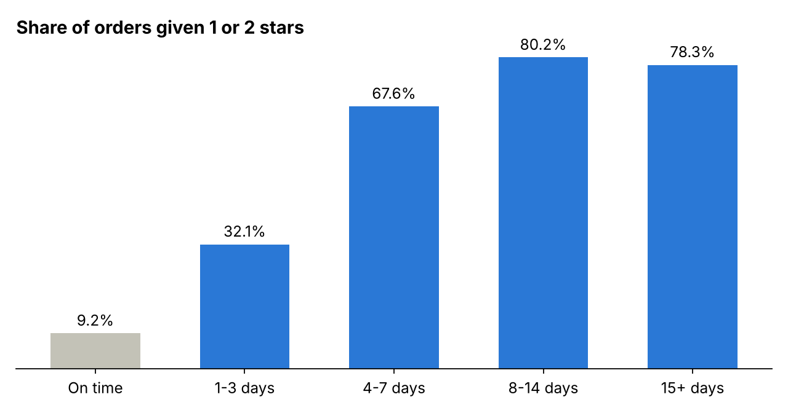
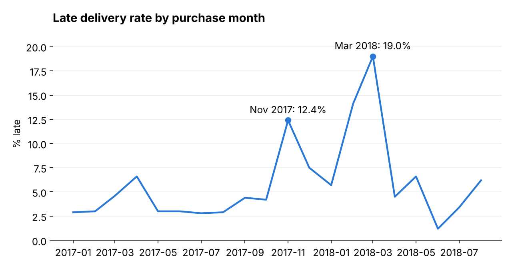

# What is damaging customer satisfaction at Olist?

SQL analysis of about 96,000 delivered orders from Olist, a Brazilian online marketplace.

## Question

Which problem most damages customer reviews, and where should the business act first?

## Data

[Olist public e-commerce dataset](https://github.com/olist/work-at-olist-data): linked tables for orders, items, customers, sellers, products, payments and reviews.

Scope: delivered orders purchased from January 2017 to August 2018, the complete months available. Revenue is in Brazilian reais and excludes freight.

## Method

1. Loaded the CSV files into SQLite and checked row counts, missing values and join keys.
2. Kept only the latest review per order, because some orders have several reviews.
3. Defined late as delivered on a later calendar day than the date promised to the customer.
4. Compared review scores by delivery timeliness, then located late orders by month, state and fulfilment stage.

Queries are in [`sql/analysis.sql`](sql/analysis.sql) and outputs are in [`results/`](results/).

## Findings

**1. Late orders were 6.7% of reviewed orders but 32.5% of 1 and 2 star reviews.** 62.4% of late orders got a low score, against 9.2% of on-time orders.

**2. About half of late orders came from three months.** November 2017, February 2018 and March 2018 held 22% of orders and about 48% of late orders. Other months averaged 4.5% late.

**3. Most late orders were not caused by a seller's late handover.** Sellers who missed their handover deadline had a 26.7% late rate against 5.6% otherwise, but account for only 22% of late orders.

**Geography matters too.** Among states with at least 1,000 orders, late rates ranged from 4.1% in Paraná to 13.8% in Ceará. Rio de Janeiro stands out for volume, at 12.1% late across 12,310 orders.

## Recommendations

1. Add carrier capacity or lengthen promised dates ahead of known peaks such as Black Friday.
2. Reset promised dates in the states with the highest late rates.
3. Contact customers proactively when an order is about to become more than three days late, the point where low scores rise sharply.
4. Enforce seller handover deadlines, as a secondary lever.

If late orders received low scores at the on-time rate, low reviews would fall by up to 28%. This is an upper estimate.

## Limitations

- The link between lateness and reviews is an association. Late orders may differ in other ways.
- Reviews exist only for customers who left one.
- The data ends in 2018, so the findings describe that period.
- Monthly late counts in finding 2 are rebuilt from rates rounded to one decimal place.

## Reproduce

Download the CSV files, load each into a SQLite table (dropping the `olist_` prefix and `_dataset` suffix), then run `sql/analysis.sql`.

## Tools

SQL (SQLite), including joins, CTEs, CASE WHEN and window functions. Python for loading data and drawing charts.

Built with AI assistance as part of learning SQL.
